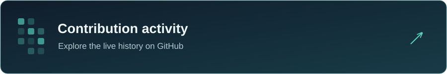

<div align="center">



<p><b>Computer Vision Engineer</b> · İzmir, Türkiye 🇹🇷</p>

<a href="https://www.linkedin.com/in/ahmed-akyol-84766622b/">LinkedIn</a> · <a href="mailto:ahmedakyll@gmail.com">Email</a> · <a href="https://github.com/llakyoll?tab=repositories">Repositories</a>

</div>

---

## `01` About

I build computer vision systems for live camera streams, edge devices, and GPU servers. My work spans detection and tracking, model optimization, and industrial camera integration.

```yaml
focus:       Real-time computer vision and edge AI
deployment:  NVIDIA Jetson · A4000 · H100
inference:   YOLO · TensorRT · ONNX
cameras:     RTSP · GigE Vision · USB3 Vision · Hikrobot MVS
location:    İzmir, Türkiye
```

I have contributed to a TÜBİTAK-funded industrial machine vision R&D project.

## `02` Toolkit

| Area | Tools |
| :--- | :--- |
| **Languages** | Python · C++ · SQL |
| **Vision & inference** | OpenCV · Ultralytics YOLO · TensorRT · ONNX |
| **Edge & GPU** | NVIDIA Jetson · CUDA · Docker |
| **Cameras & streams** | RTSP · GigE Vision · USB3 Vision · Hikrobot MVS |
| **Interfaces** | PyQt6 |

## `03` Selected work

| Project | What it does |
| :--- | :--- |
| [YOLO RTSP Data Collector](https://github.com/llakyoll/auto_labeller) | Captures RTSP frames, runs detection inside a selected region, and exports approved annotations as a YOLO dataset. |
| [Computer Vision Projects](https://github.com/llakyoll/cvProjects) | A collection of vehicle and people counting, license plate, and industrial part inspection projects. |
| [RTSP Channel Counter](https://github.com/llakyoll/rtsp_channel_counter) | Finds distinct RTSP camera channels and creates a preview collage. |
| [License Plate Detection](https://github.com/llakyoll/ocr_with_yolo_nemotron) | Detects and tracks plates in recorded vehicle video with YOLO and ByteTrack. |

## `04` Activity

<div align="center">
  <a href="https://github.com/llakyoll?tab=overview">
    
  </a>
</div>

---

<div align="center">

**Building vision systems that work beyond the notebook.**

<a href="mailto:ahmedakyll@gmail.com">Get in touch →</a>

</div>
